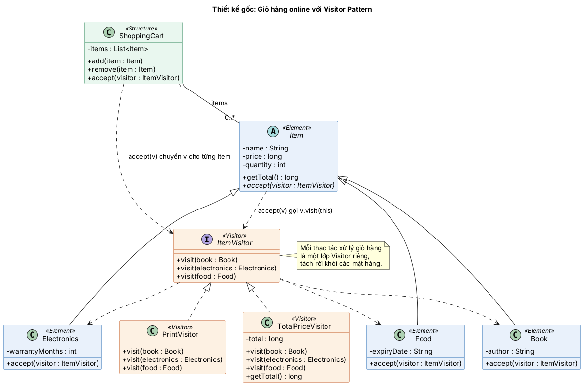
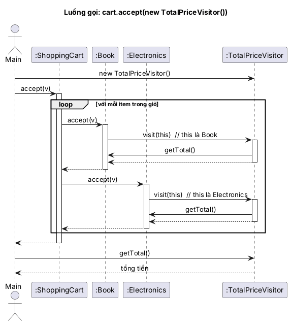
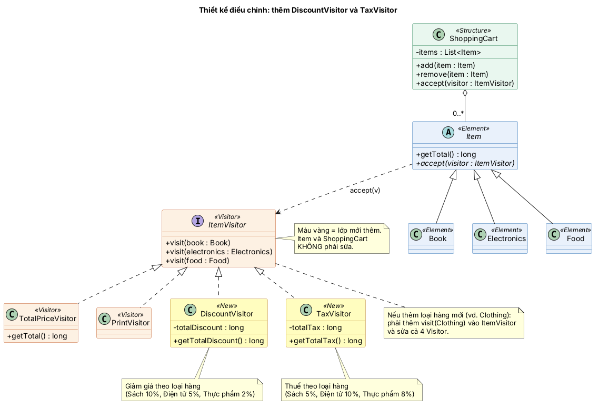

# Case study: Online Shopping Cart với Visitor Pattern

Ngôn ngữ: Java. UML: PlantUML (file `.puml` và ảnh PNG trong `diagrams/`).

## 1. Thiết kế

Giỏ hàng chứa 3 loại mặt hàng: **Sách (Book)**, **Đồ điện tử (Electronics)**, **Thực phẩm (Food)**. Các thao tác xử lý giỏ hàng được tách khỏi mặt hàng bằng **Visitor Pattern**: mỗi thao tác là một lớp Visitor riêng.



| Vai trò | Lớp | Giải thích |
|---|---|---|
| Element | `Item` (abstract) | Giữ tên, đơn giá, số lượng; có `getTotal()` và `accept(visitor)` |
| ConcreteElement | `Book`, `Electronics`, `Food` | Mỗi lớp có thêm một thuộc tính riêng (tác giả, số tháng bảo hành, hạn sử dụng) và cài `accept` bằng `visitor.visit(this)` |
| Visitor | `ItemVisitor` | Có `visit` cho từng loại hàng |
| ConcreteVisitor | `TotalPriceVisitor`, `PrintVisitor` | 2 thao tác xử lý gốc |
| ObjectStructure | `ShoppingCart` | Chứa danh sách `Item`; có `add`, `remove`, `accept(visitor)` |

**2 thao tác xử lý gốc (tách rời mặt hàng):**

1. `TotalPriceVisitor`: tính tổng tiền hàng.
2. `PrintVisitor`: in thông tin giỏ hàng, mỗi loại hàng in thông tin riêng.

**Cơ chế hoạt động (double dispatch):** `cart.accept(v)` gọi `item.accept(v)` cho từng mặt hàng; bên trong, mặt hàng gọi `v.visit(this)`. Vì `this` có kiểu cụ thể (Book, Electronics hoặc Food) nên Java tự chọn đúng phương thức `visit` mà không cần `if` hay `instanceof`.



## 2. Cài đặt

| File | Vai trò |
|---|---|
| `Item.java`, `Book.java`, `Electronics.java`, `Food.java` | Mặt hàng |
| `ItemVisitor.java` | Interface Visitor |
| `ShoppingCart.java` | Giỏ hàng |
| `TotalPriceVisitor.java`, `PrintVisitor.java` | Thao tác gốc |
| `DiscountVisitor.java`, `TaxVisitor.java` | Thao tác bổ sung |
| `Main.java` | Chạy thử |

```bash
javac -encoding UTF-8 *.java
java -Dfile.encoding=UTF-8 Main
```

Kết quả chạy:

```
=== Giỏ hàng ===
[Sách] Design Patterns - tác giả: GoF | SL: 2 | 900000 VND
[Điện tử] Tai nghe Bluetooth - bảo hành: 12 tháng | SL: 1 | 1200000 VND
[Thực phẩm] Sữa tươi - HSD: 2026-12-30 | SL: 5 | 150000 VND
Tổng tiền hàng: 2250000 VND
Giảm giá: 153000 VND
Thuế: 177000 VND
Thanh toán: 2274000 VND

Sau khi xóa 'Sữa tươi', tổng tiền hàng: 2100000 VND
```

## 3. Bổ sung thao tác xử lý và thiết kế điều chỉnh

Thêm 2 thao tác mới (tỉ lệ là giá trị giả định để minh họa):

1. `DiscountVisitor`: tính giảm giá theo loại hàng (Sách 10%, Điện tử 5%, Thực phẩm 2%).
2. `TaxVisitor`: tính thuế theo loại hàng (Sách 5%, Điện tử 10%, Thực phẩm 8%).



Điều chỉnh: **chỉ thêm 2 lớp Visitor mới** (màu vàng). Các lớp `Item`, `Book`, `Electronics`, `Food`, `ShoppingCart`, `ItemVisitor` và hai visitor cũ không phải sửa.

## 4. Nhận xét về khả năng mở rộng

| Việc cần làm | Mức độ | Lý do |
|---|---|---|
| Thêm thao tác mới (ví dụ xuất file, kiểm tra tồn kho) | Dễ | Chỉ thêm một lớp Visitor mới, không sửa mã cũ (đã làm với `DiscountVisitor`, `TaxVisitor`) |
| Thêm loại hàng mới (ví dụ `Clothing`) | Khó | Phải thêm `visit(Clothing)` vào `ItemVisitor` và sửa cả 4 Visitor hiện có |

Kết luận: Visitor phù hợp khi **các loại hàng ít thay đổi nhưng thao tác xử lý thay đổi/thêm thường xuyên**.

## 5. Khó khăn khi áp dụng Visitor

1. **Thêm loại hàng mới phải sửa nhiều nơi:** interface `ItemVisitor` và tất cả Visitor (xem mục 4).
2. **Lộ dữ liệu nội bộ:** Visitor cần đọc thuộc tính riêng của từng loại hàng nên mặt hàng phải có getter công khai (`getAuthor`, `getWarrantyMonths`, `getExpiryDate`).
3. **Phụ thuộc hai chiều:** `Item` biết `ItemVisitor`, còn `ItemVisitor` biết toàn bộ các lớp hàng cụ thể.
4. **Visitor phải lưu kết quả trong biến (`total`, `totalDiscount`...):** mỗi lần dùng phải tạo visitor mới.
5. **Khó xử lý quy tắc liên quan nhiều mặt hàng** (ví dụ giảm giá theo tổng giỏ, mua sách tặng quà): vì Visitor xử lý từng mặt hàng một.
6. **Lặp code:** mỗi lớp hàng đều có `accept` giống hệt nhau, mỗi Visitor phải cài đủ phương thức cho mọi loại hàng dù có loại xử lý giống nhau.
7. **Khó hiểu hơn gọi hàm bình thường:** cơ chế double dispatch cần giải thích cho người mới.
